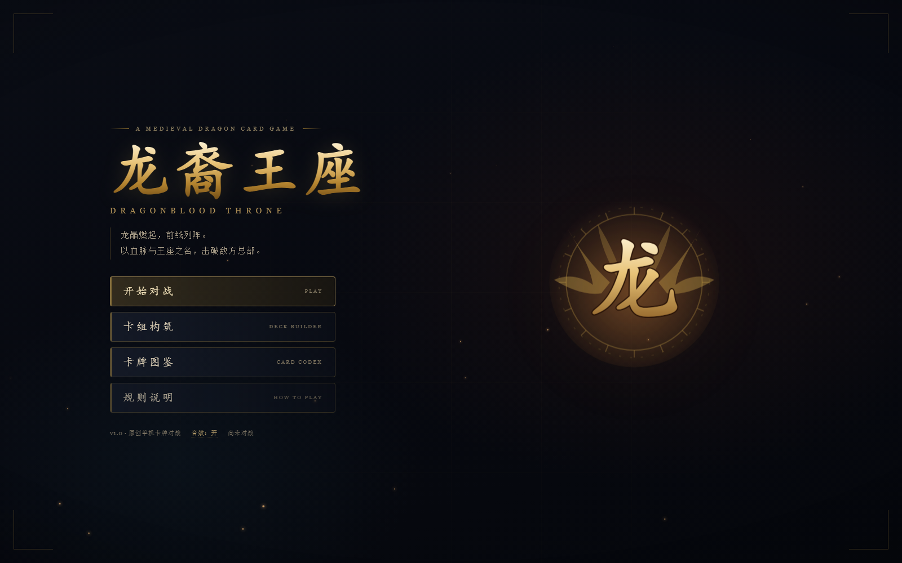
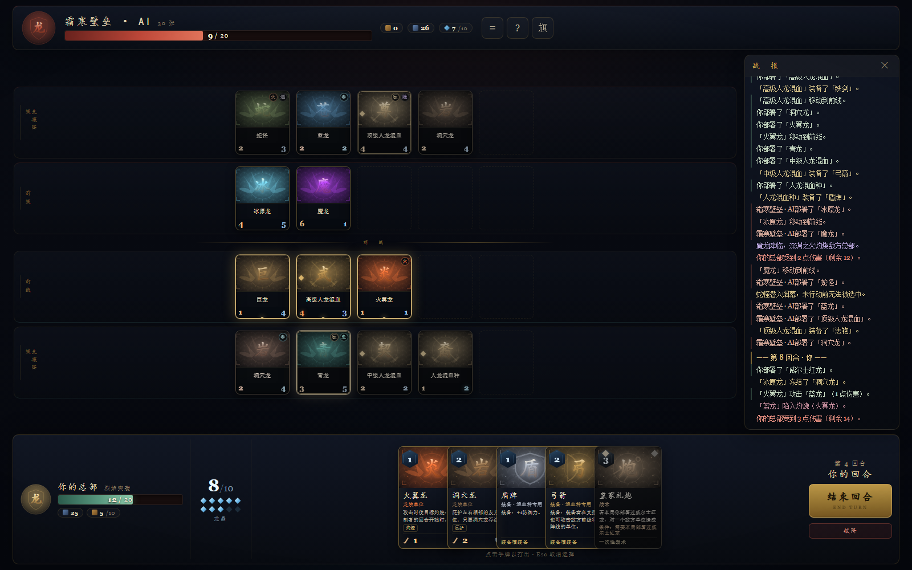
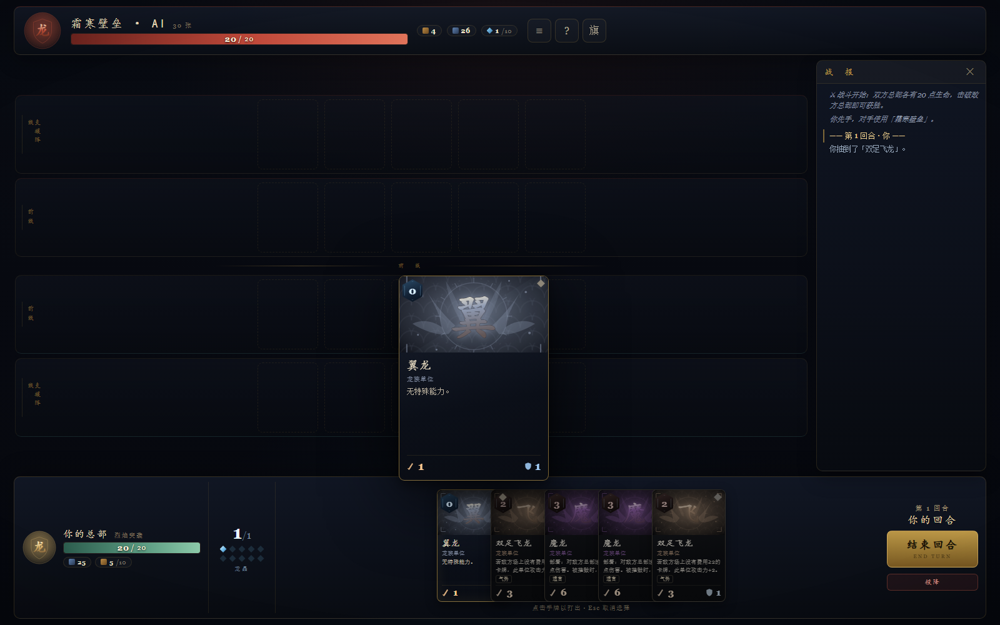
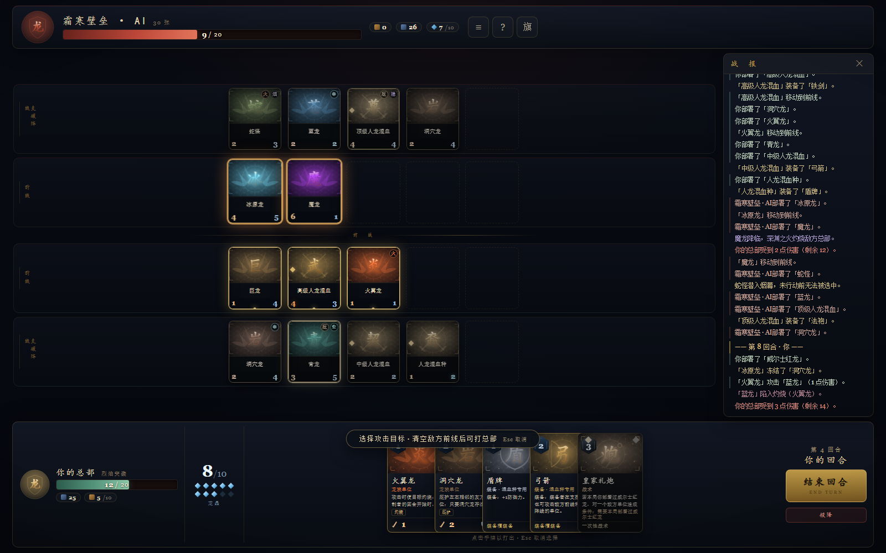
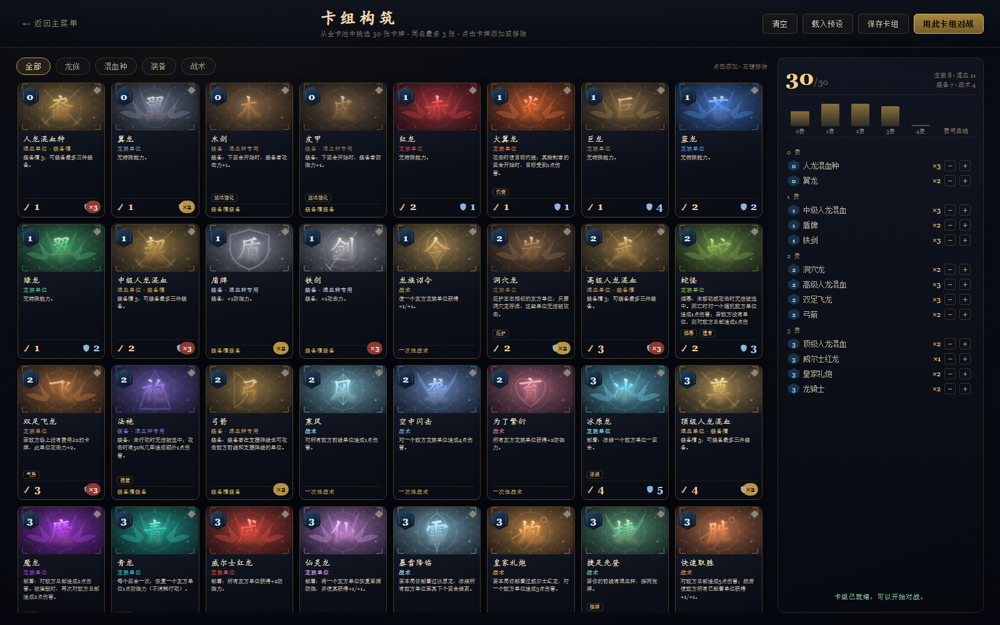
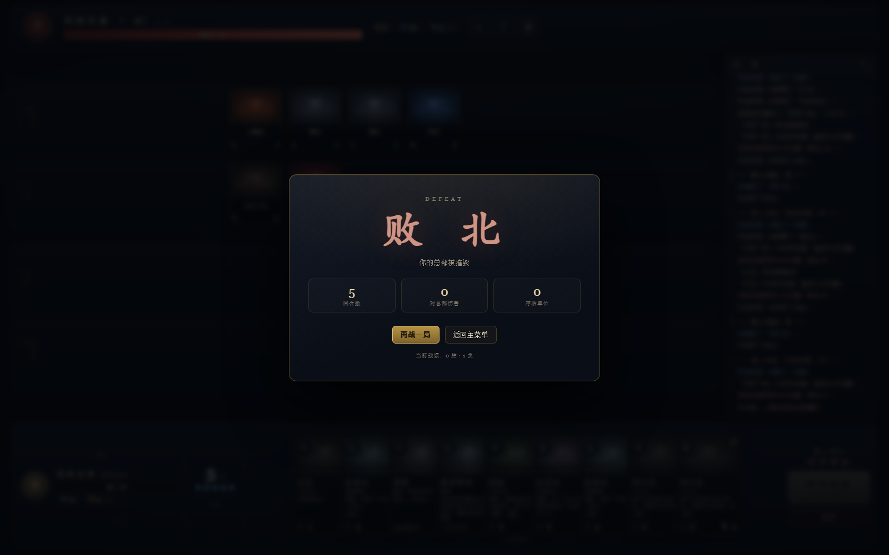

# 龙裔王座 · Dragonblood Throne

**一款中世纪龙族主题的原创单机卡牌对战游戏：率领龙群与人龙混血种，用龙晶部署单位、争夺前线，击破 20 点生命的敌方总部。**

*A medieval dragon-themed single-player card battler built with vanilla HTML, CSS and JavaScript — no frameworks, no network, fully offline.*

[](LICENSE)
[](https://github.com/nike-cpu/dragonblood-throne/actions/workflows/test.yml)
[](js/)
[](龙裔王座-离线版.html)

🌐 **在线试玩**：<https://nike-cpu.github.io/dragonblood-throne/>  
💾 **单文件离线版**：[龙裔王座-离线版.html](龙裔王座-离线版.html) · “另存为”后双击即可离线游玩  
📦 **源码**：<https://github.com/nike-cpu/dragonblood-throne>

`v1.0` · 原创单机 · HTML / CSS / 原生 JavaScript · 无构建 · 无外部依赖 · 可离线运行

---

## 目录

- [项目速览](#项目速览)
- [特色](#特色)
- [如何开始](#如何开始)
- [玩法速览](#玩法速览)
- [界面操作](#界面操作)
- [三套预设卡组](#三套预设卡组)
- [卡牌一览（39 张）](#卡牌一览39-张)
- [项目结构](#项目结构)
- [技术说明](#技术说明)
- [测试与开发](#测试与开发)
- [规则设计说明：歧义与裁定](#规则设计说明歧义与裁定)
- [截图展示](#截图展示)
- [版权与原创声明](#版权与原创声明)
- [延伸阅读](#延伸阅读)

---

## 项目速览

| 项目 | 内容 |
| --- | --- |
| 游戏类型 | 单机卡牌对战 / 双阵线争夺 |
| 主题 | 中世纪王国、龙族、人龙混血种、龙晶与王座 |
| 对局人数 | 1 人 vs 电脑对手 |
| 单局时长 | 约 5–10 分钟（随卡组与节奏变化） |
| 运行平台 | 桌面浏览器；Windows 下双击即可游玩 |
| 技术栈 | HTML、CSS、原生 JavaScript；无框架、无构建、无网络请求 |
| 内容规模 | 39 张卡牌、3 套预设卡组、30 张自定义卡组构筑 |
| 版本 | v1.0 |

---

## 特色

- **双阵线战场**：每侧分为「支援阵线」与「前线」，各最多 5 个单位。只有前线单位能攻击总部；敌方前线存在单位时，总部与支援阵线都无法被普通攻击选中，必须先清场或使用直接伤害技能/卡牌。
- **20 点总部攻防**：双方总部各有 20 点生命，先将对方总部降为 0 的一方获胜；对局短促，决策集中。
- **龙晶曲线**：第 1 回合 1 颗龙晶，之后每回合上限 +1，最多 10 颗；回合开始自动补满，不累积。
- **同时结算的战斗**：攻击者对目标造成攻击力伤害，目标同时以自身攻击力反击；即使目标会被摧毁，也会打出反击。
- **39 张原创卡牌**：20 张单位（16 张龙族、4 张人龙混血种）、6 张装备、13 张战术，费用覆盖 0–4。
- **装备槽与混血种**：每个人龙混血种拥有 **3 个装备槽**，可装备最多三件装备；新增 0 费「木剑 / 皮甲」，在下个回合开始时分别提供 +1 攻击 / +1 防御。装备随单位一起被摧毁。
- **多套节奏**：烈焰突袭（速攻）、霜寒壁垒（控制）、混血军团（中速），三套预设各有不同的胜利方式。
- **卡组构筑**：从全卡池挑选 30 张，同名最多 3 张；卡组保存在浏览器本地。
- **电脑对手**：启发式评估出牌与战斗，会抢总部、处理威胁、使用装备与战术，也会移动到前线后继续攻击。
- **纯程序化表现**：卡面、徽记、图标均为 SVG 程序化绘制；音效由 WebAudio 实时合成，没有外部图片、音频或字体文件。
- **战斗演出**：单位攻击与移动有约 1 秒的前摇，并附带尘土、风环、刀光、冲击与屏幕震动；部署时扬起尘土与风，移除/治疗/冻结/灼烧也有对应反馈。
- **单机离线**：无账号、无联网、无内购、无外部请求；打开 `index.html` 即玩。

---

## 如何开始

### 免安装离线版（推荐）

- **单文件版**：双击项目根目录下的 **`龙裔王座-离线版.html`**。CSS、JavaScript、SVG 卡面全部内联，页面带 CSP 禁止任何外部网络请求，复制到任何没有网络的电脑都能直接玩。
- **一键启动版**：从 [Releases](https://github.com/nike-cpu/dragonblood-throne/releases) 下载离线包，解压后双击 **`开始游戏.vbs`**，会用 Windows 自带的 Edge 以无地址栏的应用窗口打开游戏；如果系统禁用了 VBS，双击 **`开始游戏.bat`** 或直接双击 `game.html`。
- 无需安装、无需管理员权限、无需 Node.js 或本地服务器；存档保存在本机 Edge 配置目录/浏览器本地存储中。

### Windows（开发/网页版）

1. 双击项目根目录下的 **`index.html`**。
2. 或双击 **`启动游戏.bat`**。它会先切换到脚本所在目录，再用系统默认浏览器打开 `index.html`。

### 浏览器建议

- 推荐使用较新的 **Microsoft Edge、Google Chrome 或 Mozilla Firefox**。
- 建议窗口不小于 **1280 × 720**；在 **1600 × 1000** 左右或全屏（F11）下布局最完整。
- 不需要安装 Node.js，不需要本地服务器，也不需要联网。
- 首次点击页面后音效才会启用，这是浏览器的自动播放限制；标题页底部的「音效：开 / 关」可随时切换。
- 若浏览器对 `file://` 页面的本地存储限制较严，卡组与战绩可能无法保存；游戏本身仍可正常进行。换用 Edge / Chrome 通常可以正常保存。

---

## 玩法速览

| 项目 | 规则 |
| --- | --- |
| 胜利目标 | 将敌方总部生命从 20 降为 0；总部归零即败。牌库耗尽后抽牌会受到递增疲劳伤害。 |
| 先手 | 玩家固定先手。双方开局各抽 4 张；先手方在第一个回合开始再抽 1 张（开局手牌为 5 张），后手方在自己的首个回合抽到第 5 张。当前版本没有换牌与先手补偿。 |
| 回合 | 双方轮流行动。自己的回合开始时：龙晶上限 +1 并补满、己方单位恢复行动、结算己方单位灼烧、抽 1 张牌；若灼烧/遗言已分出胜负，则不再抽牌。 |
| 龙晶 | 第 1 回合 1 颗，之后每回合上限 +1，最多 10 颗；回合开始补满，未花费的龙晶不保留。 |
| 手牌与牌库 | 牌库 30 张；手牌上限 10 张。手牌已满时抽到的牌会被烧毁。牌库为空时抽牌改为疲劳伤害，伤害逐次递增。 |
| 阵线 | 每侧有支援阵线与前线，各最多 5 个单位。新部署的单位进入支援阵线，且当回合疲惫。 |
| 移动 | 单位可从支援阵线移动到前线，每回合一次；移动不消耗攻击，之后仍可攻击。前线已满时不能移动。 |
| 攻击 | 前线单位可攻击敌方前线单位；只有敌方前线没有单位时，才能攻击敌方总部或敌方支援阵线。特殊技能/卡牌（如魔龙、快速取胜）可直接对总部造成伤害，不受前线阻挡。 |
| 支援阵线攻击 | 普通支援阵线单位不能攻击；装备「弓箭」的混血种可以攻击敌方前线和支援阵线的单位，但不能攻击总部。 |
| 反击 | 战斗同时结算：目标以自身攻击力反击攻击者，即使目标会被这次攻击摧毁。总部不会反击。 |
| 疲惫 | 新部署的单位、本回合已攻击的单位处于疲惫，不能攻击或移动；自己的回合开始时恢复。当前版本移动本身不会使单位疲惫。 |
| 卡牌类型 | 单位牌部署到支援阵线；装备牌只能装备给有装备槽的混血种；战术牌立即结算，一次性生效。 |
| 对局结束 | 总部归零、投降或牌库疲劳致死都会结束对局。结算界面可「再战一局」或返回主菜单。 |

### 状态与关键词

| 关键词 | 说明 |
| --- | --- |
| 灼烧 | 目标须为单位；在其控制者的回合开始时受到 1 点伤害。持续存在，不会自动消失，重复施加不叠加。总部不会获得灼烧。 |
| 冻结 | 无法移动或攻击；仍可被攻击、被指定，被冻结单位仍会反击，青龙的免费疗愈也不受影响。持续到其控制者的回合结束时解冻。 |
| 烟幕 | 未移动或攻击时无法被选中；蛇怪专属。移动或攻击后烟幕消失。 |
| 庇护 | 洞穴龙使左右相邻的友方单位无法被攻击；只保护同一阵线的相邻单位，不保护洞穴龙自身。两只相邻洞穴龙可以互相庇护。 |
| 隐匿（法袍） | 装备法袍的单位在尚未行动时无法被选中（刚部署的当回合也隐匿）；移动或攻击后暴露，下个自己的回合重新隐匿。 |
| 装备槽 | 每个人龙混血种拥有 3 个装备槽，最多装备 3 件装备；装备不能被转移，随单位一起被摧毁。木剑/皮甲在下个回合开始时生效。 |
| 疲惫 | 新部署或已行动的单位无法攻击、移动；自己的回合开始时恢复行动。 |
| 疲劳 | 牌库为空时抽牌，总部受到递增伤害（1、2、3……）。 |
| 气势 | 双足飞龙的动态能力：敌方场上没有费用 ≥2 的单位时，攻击力 +2。 |
| 疗愈 | 青龙每回合一次，恢复一个友方单位 1 点防御力，不消耗行动；即使青龙被冻结或当回合刚部署也可使用。 |
| 遗言 | 单位被摧毁时触发的能力（魔龙、蛇怪）。 |
| 移除（龙之笛） | 将单位移出战场；有 10% 几率加入施放者手牌；不触发遗言，不计入死亡。 |

> 规则细节与边界裁定见 [规则设计说明](#规则设计说明歧义与裁定)；完整定义与代码依据见 [游戏设计文档](docs/游戏设计文档.md)。

### 卡牌类型

| 类型 | 数量 | 说明 |
| --- | --- | --- |
| 单位 | 20 | 16 张龙族单位 + 4 张人龙混血种；部署在支援阵线，可移动、攻击。 |
| 装备 | 6 | 木剑、皮甲、盾牌、铁剑、弓箭、法袍；只能装备给拥有装备槽的混血种。 |
| 战术 | 13 | 龙族诏令、为了繁衍、寒风、空中闪击、死亡降临、龙骑士、皇家礼炮、暴雪降临、龙之笛、捷足先登、快速取胜、龙巢维修、最后一搏；一次性结算。 |
| **合计** | **39** | 费用覆盖 0–4。 |

> **代码核对说明**：`js/cards.js` 把「龙之笛」排在装备卡数据段，但它的 `type` 是 `tactic`，效果也是一次性移除，不占用装备槽。因此按实际类型统计为 **6 张装备、13 张战术**；图鉴的「装备」筛选同样只显示 6 张。

---

## 界面操作

| 操作 | 效果 |
| --- | --- |
| 点击手牌 | 选中卡牌。单位牌随后点击自己的支援阵线部署；需要目标的牌会高亮合法目标；无需目标的战术牌再次点击手牌即可打出。 |
| 点击高亮单位 / 敌方总部 | 在出牌或攻击选择中确认目标。攻击总部时点击顶部敌方总部区域（需敌方前线为空）；冰原龙/仙灵龙等可选目标卡在选择目标时，提示条会显示「跳过目标」。 |
| 点击己方单位 | 打开行动菜单：可攻击时显示「攻击」，可移动时显示「移动到前线」，青龙显示「疗愈友方（每回合一次）」；同时显示单位属性、状态与卡牌文本。 |
| 点击敌方单位 | 查看其属性、状态、装备与能力说明；不会执行行动。 |
| 悬停手牌 | 显示放大的卡牌预览（桌面端）。 |
| 结束回合 | 点击右下角「结束回合」，交给电脑对手。 |
| `Esc` | 依次关闭单位菜单、弹窗或取消当前选择；结算弹窗为锁定状态，不能用 `Esc` 关闭。 |
| 战报 | 宽屏下战报常驻右侧；窄屏（≤1320px）下可用顶部「≡」按钮展开 / 收起。 |
| 规则 / 投降 | 对局顶部「?」打开规则说明；顶部「旗」或右下角「投降」按钮打开投降确认，确认后本局记为失败。 |
| 结算 | 显示胜负、原因、回合数、对总部伤害、存活单位与当前战绩；可选择「再战一局」（沿用双方卡组，重新洗牌）或「返回主菜单」。 |
| 卡组构筑 | 点击左侧卡牌加入，右键移除；也可用右侧列表的「+ / −」。支持清空、载入预设、保存卡组、用此卡组对战。 |

> 当前版本以鼠标操作为主，未实现完整的键盘导航或触摸专用操作；`Esc` 是唯一的全局快捷键。按钮与单位卡带有 `aria-label` / `role` 等基础无障碍标记，焦点可见样式已提供。

---

## 三套预设卡组

三套预设均为 **30 张、同名不超过 3 张** 的合法卡组。开始对战时，电脑会从「不同于你选择的预设」中随机挑选一套应战；如果你使用自定义卡组，电脑会从三套预设中随机选择。

### 烈焰突袭 · EMBER ASSAULT（速攻）

> 以低费龙群抢占地盘，用灼烧与冲锋直接压垮总部。

**核心打法**：用 0–1 费龙族迅速铺场，火翼龙把灼烧挂到敌方单位身上，双足飞龙在敌方缺少大单位时打出 5 点攻击，魔龙提供部署与遗言的 2+2 点总部直伤。威尔士红龙为全队 +2 防御，龙骑士在龙族与混血种同时站场时给出全场 +2/+2，作为中后期收束。

**优势**：前期节奏快，直伤多，能给控制卡组压力。
**注意**：手牌消耗快，遇到洞穴龙、仙灵龙、青龙这类恢复与防御体系时容易后劲不足；皇家礼炮需要本局部署过威尔士红龙才能打出。

### 霜寒壁垒 · FROST BULWARK（控制）

> 以洞穴龙与巨兽筑起高墙，冻结并慢慢碾碎对手。

**核心打法**：用巨龙、绿龙、洞穴龙建立高防御阵线；洞穴龙庇护左右邻居，让对手难以清理关键单位。冰原龙与暴雪降临冻结敌方单位，争取回合；仙灵龙修复并强化友方单位，青龙每回合免费回复 1 点防御。蛇怪以烟幕保护自己，死亡时还能造成 1 点随机伤害。最终靠场面存活、反击与疲劳压垮对手。

**优势**：防御与恢复充足，擅长对抗依赖交换的速攻与中速。
**注意**：进攻速度偏慢，缺乏直接终结手段；暴雪降临需要本局部署过冰原龙。

### 混血军团 · HYBRID LEGION（中速）

> 以人龙混血种的装备槽滚起雪球，龙骑士与礼炮终结战局。

**核心打法**：人龙混血种从 0 费到 3 费形成完整曲线，每个人可以装备最多三件武器或防具。木剑/皮甲在下个回合开始时提供 +1 攻击/防御；铁剑提升攻击，盾牌提升防御，弓箭让支援阵线的混血种直接攻击敌方两线单位，法袍提供隐匿与 50% 的额外伤害。龙骑士在同时控制混血种和龙族时给全场 +2/+2；皇家礼炮在威尔士红龙登场后提供 5 点定点伤害。

**优势**：单卡质量高，装备滚雪球能力强，中期爆发高。
**注意**：装备需要额外的龙晶与手牌投入；如果关键混血种被移除或集火，装备会随单位一起损失。

---

## 卡牌一览（39 张）

> 以下数据逐项核对 `js/cards.js`。费用按 0 → 4 分组；同费用内按单位 → 装备 → 战术排列。攻/防中的「—」表示非单位卡。
>
> 新增的「北欧白龙 / 精灵龙 / 捷足先登 / 快速取胜 / 龙巢维修 / 最后一搏 / 木剑 / 皮甲」可以直接在卡组构筑中加入；三套预设仍保持原有的 30 张构成。

### 0 费（4 张）

| 名称 | 费用 | 攻/防 | 种族 / 类型 | 稀有度 | 效果摘要 |
| --- | ---: | --- | --- | --- | --- |
| 翼龙 | 0 | 1 / 1 | 龙族单位 | 普通 | 无特殊能力。 |
| 人龙混血种 | 0 | 1 / 1 | 混血单位（装备槽 3） | 普通 | 装备槽 3：可装备最多三件装备。 |
| 木剑 | 0 | — | 装备（混血种专用） | 普通 | 装备：下回合开始时，装备者攻击力 +1。 |
| 皮甲 | 0 | — | 装备（混血种专用） | 普通 | 装备：下回合开始时，装备者防御力 +1。 |

### 1 费（9 张）

| 名称 | 费用 | 攻/防 | 种族 / 类型 | 稀有度 | 效果摘要 |
| --- | ---: | --- | --- | --- | --- |
| 火翼龙 | 1 | 1 / 1 | 龙族单位 | 精良 | 攻击单位目标时使其灼烧：其控制者回合开始时受到 1 点伤害。 |
| 巨龙 | 1 | 1 / 4 | 龙族单位 | 精良 | 无特殊能力。 |
| 红龙 | 1 | 2 / 1 | 龙族单位 | 普通 | 无特殊能力。 |
| 绿龙 | 1 | 1 / 2 | 龙族单位 | 普通 | 无特殊能力。 |
| 蓝龙 | 1 | 2 / 2 | 龙族单位 | 普通 | 无特殊能力。 |
| 中级人龙混血 | 1 | 2 / 2 | 混血单位（装备槽 3） | 精良 | 装备槽 3：可装备最多三件装备。 |
| 盾牌 | 1 | — | 装备（混血种专用） | 普通 | 装备：+1 防御力。 |
| 铁剑 | 1 | — | 装备（混血种专用） | 普通 | 装备：+1 攻击力。 |
| 龙族诏令 | 1 | — | 战术 | 普通 | 使一个友方龙族单位获得 +1/+1。 |

### 2 费（9 张）

| 名称 | 费用 | 攻/防 | 种族 / 类型 | 稀有度 | 效果摘要 |
| --- | ---: | --- | --- | --- | --- |
| 双足飞龙 | 2 | 3 / 1 | 龙族单位 | 精良 | 若敌方场上没有费用 ≥2 的卡牌，此单位攻击力 +2。 |
| 洞穴龙 | 2 | 2 / 4 | 龙族单位 | 精良 | 庇护左右相邻的友方单位：只要洞穴龙存活，这些单位无法被攻击。 |
| 蛇怪 | 2 | 2 / 3 | 龙族单位 | 精良 | 烟幕：未移动或攻击时无法被选中。死亡时对一个随机敌方单位造成 1 点伤害；若敌方没有单位，则对敌方总部造成 1 点伤害。 |
| 高级人龙混血 | 2 | 3 / 3 | 混血单位（装备槽 3） | 精良 | 装备槽 3：可装备最多三件装备。 |
| 弓箭 | 2 | — | 装备（混血种专用） | 精良 | 装备者在支援阵线也可攻击敌方前线和支援阵线的单位；不能攻击总部。 |
| 法袍 | 2 | — | 装备（混血种专用） | 精良 | 未行动时无法被选中；攻击时有 50% 几率造成额外 1 点伤害。 |
| 为了繁衍 | 2 | — | 战术 | 精良 | 所有友方龙族单位获得 +2 防御力。 |
| 寒风 | 2 | — | 战术 | 精良 | 对所有敌方前线单位造成 1 点伤害。 |
| 空中闪击 | 2 | — | 战术 | 精良 | 对一个敌方龙族单位造成 4 点伤害。 |

### 3 费（13 张）

| 名称 | 费用 | 攻/防 | 种族 / 类型 | 稀有度 | 效果摘要 |
| --- | ---: | --- | --- | --- | --- |
| 冰原龙 | 3 | 4 / 5 | 龙族单位 | 史诗 | 部署：冻结一个敌方单位一回合。 |
| 仙灵龙 | 3 | 2 / 5 | 龙族单位 | 史诗 | 部署：将一个友方单位恢复至满防御，并使其获得 +1/+1；未指定目标时强化自身。 |
| 魔龙 | 3 | 6 / 1 | 龙族单位 | 史诗 | 部署：对敌方总部造成 2 点伤害。被摧毁时，再次对敌方总部造成 2 点伤害。 |
| 威尔士红龙 | 3 | 4 / 4 | 龙族单位 | 传说 | 部署：所有友方单位获得 +2 防御力。 |
| 青龙 | 3 | 3 / 5 | 龙族单位 | 史诗 | 每个回合一次：恢复一个友方单位 1 点防御力（不消耗行动）。 |
| 顶级人龙混血 | 3 | 4 / 4 | 混血单位（装备槽 3） | 史诗 | 装备槽 3：可装备最多三件装备。 |
| 龙之笛 | 3 | — | 战术 | 史诗 | 一次性：移除一个敌方龙族单位。有10%几率将其加入你的手牌。 |
| 死亡降临 | 3 | — | 战术 | 史诗 | 随机消灭一个敌方单位。 |
| 龙骑士 | 3 | — | 战术 | 史诗 | 若你同时控制混血种和龙族，所有友方单位获得 +2/+2。 |
| 皇家礼炮 | 3 | — | 战术 | 精良 | 若本局你部署过威尔士红龙，对一个敌方单位造成 5 点伤害。 |
| 暴雪降临 | 3 | — | 战术 | 史诗 | 若本局你部署过冰原龙，冻结所有敌方单位至其下个回合结束。 |
| 捷足先登 | 3 | — | 战术 | 精良 | 若你的前线有混血种，抽两张牌。 |
| 快速取胜 | 3 | — | 战术 | 精良 | 对敌方总部造成 5 点伤害；然后使敌方所有已部署单位获得 +1/+1。 |

### 4 费（4 张）

| 名称 | 费用 | 攻/防 | 种族 / 类型 | 稀有度 | 效果摘要 |
| --- | ---: | --- | --- | --- | --- |
| 北欧白龙 | 4 | 10 / 6 | 龙族单位 | 史诗 | 此单位无法攻击总部。 |
| 精灵龙 | 4 | 6 / 3 | 龙族单位 | 史诗 | 任意一方每部署一个费用≥3的单位，获得 +1 防御力（不包含自身）。 |
| 龙巢维修 | 4 | — | 战术 | 史诗 | 若你的总部生命低于10：恢复8点总部生命，并检索一张费用≥3的龙族单位卡加入手牌。 |
| 最后一搏 | 4 | — | 战术 | 史诗 | 将你的总部生命设为1；使你的所有单位获得 +4/+4。 |

---

## 项目结构

```text
dragonblood-throne/
├─ index.html                 页面结构、三个主界面与脚本加载顺序
├─ 龙裔王座-离线版.html        单文件离线版（CSS/JS 全内联，CSP 禁网）
├─ 启动游戏.bat               Windows 快捷启动脚本
├─ icon.ico                   应用图标
├─ README.md                  本文件
├─ css/
│  └─ style.css               暗色中世纪视觉、布局、响应式与动画
├─ js/
│  ├─ cards.js                39 张卡牌数据、三套预设、卡组校验
│  ├─ engine.js               纯规则引擎：回合、龙晶、阵线、战斗、状态、结算
│  ├─ ai.js                   电脑对手的启发式出牌与战斗决策
│  ├─ art.js                  程序化 SVG 卡面、图标、总部徽记、标题龙纹
│  ├─ audio.js                WebAudio 程序化音效
│  └─ ui.js                   界面流程、点击交互、动画、战报、卡组构筑
├─ tests/
│  └─ engine.test.js          59 项规则引擎测试
├─ tools/
│  ├─ qa.js                   无头 Edge 截图与布局检查
│  ├─ functest.js             无头 Edge 真实点击 UI 功能测试
│  ├─ matchtest.js            完整对局、结算与再战流程测试
│  ├─ build-offline.js        生成单文件离线 HTML
│  ├─ test-offline.js         单文件离线版无头冒烟测试（无外部资源）
│  └─ build-offline-package.js 生成免安装离线启动包
├─ screenshots/
│  ├─ 01-title.png            标题界面
│  ├─ 02-battle-start.png     对战开局
│  ├─ 03-battle-mid.png       对战中局
│  ├─ 04-codex.png            卡牌图鉴
│  ├─ 05-rules.png            规则说明
│  ├─ 06-deckbuild.png        卡组构筑
│  ├─ 07-functest.png         功能测试截图
│  ├─ 08-result.png           结算界面
│  ├─ 09-card-preview.png     手牌悬停预览
│  ├─ 10-deck-select.png      卡组选择
│  └─ 11-targeting.png        攻击目标高亮
└─ docs/
   └─ 游戏设计文档.md         完整设计文档
```

> `tools/qa.js`、`tools/functest.js` 与 `tools/matchtest.js` 会在系统临时目录创建独立的无头 Edge 配置目录（`dbt-edge-*`），用于隔离测试环境；它们不是游戏资源，可安全删除。

---

## 技术说明

### 架构与加载顺序

游戏是**纯前端、无构建**的静态页面。`index.html` 按以下顺序加载脚本，各模块通过全局对象协作：

```text
cards.js  →  engine.js  →  ai.js  →  art.js  →  audio.js  →  ui.js
DBCards      DBEngine      DBAI      DBArt      DBAudio      DBUI
```

- `cards.js`：纯数据与卡组校验，可被 Node 直接 `require`。
- `engine.js`：不依赖 DOM 的规则引擎；只通过公开动作修改状态，可在 Node 中测试。
- `ai.js`：只调用引擎公开动作，不直接篡改战场；与玩家使用同一套规则。
- `art.js` / `audio.js`：无外部资源的程序化 SVG 与 WebAudio。
- `ui.js`：DOM 渲染、事件委托、选择状态、动画队列、AI 回合调度、本地存储。

### 无外部依赖与离线运行

- 没有 `package.json`、没有 npm 依赖、没有构建步骤、没有网络请求。
- 不使用外部图片、音频、字体文件或第三方库；字体使用系统字体栈（Georgia / Times New Roman / Songti / STSong / SimSun；标题与卡名使用 KaiTi / STKaiti / Kaiti SC / FangSong）。
- 所有卡面、图标、总部徽记与标题龙纹都由 `art.js` 拼装 SVG；所有音效由 `audio.js` 用振荡器与噪声实时合成。
- 因此可以直接以 `file://` 打开，也可以放到任意静态文件服务器上；不需要后端。

### 程序化 SVG 卡面

- 卡面使用 `viewBox="0 0 160 100"` 的 SVG，包含径向渐变底、龙鳞纹理、符文圆环、刻度、角标与一个大号汉字字形。
- 龙族单位使用双翼纹样；混血种使用交叉双剑；装备使用盾、剑、弓、袍、笛的线稿；战术使用雪、心、翼、骷髅、骑士、炮等符印。
- 每张卡在数据中带有 `accent` 强调色，卡面、卡框、稀有度宝石与手牌高亮都围绕该色生成。
- 这些图形是**抽象符文风格**，不是写实插画，也不依赖任何图片素材。

### WebAudio 音效

- 使用 `AudioContext` 的振荡器（sine / triangle / square / sawtooth）与噪声缓冲，经滤波与增益包络合成。
- 音效覆盖点击、选择、错误、抽牌、部署、攻击、受伤、死亡、治疗、增益、冻结、灼烧、装备、回合、胜利、失败、投降等事件。
- 主增益较低，避免刺耳；标题页可开关音效，设置保存在本地。
- 当前版本只有音效，没有背景音乐。

### 本地存储

| 键 | 内容 | 写入时机 |
| --- | --- | --- |
| `dbt.settings.v1` | `{ "sfx": true / false }` | 标题页切换音效时 |
| `dbt.customDeck.v1` | 30 个卡牌 id 的数组 | 卡组构筑中保存合法卡组时 |
| `dbt.record.v1` | `{ "wins": 数字, "losses": 数字 }` | 每局结算时 |

- 读取失败、JSON 损坏或卡组非法时会回退到默认值，不会阻止游戏启动。
- 自定义卡组只有在通过「正好 30 张、同名 ≤3、id 合法」校验后才会被载入。
- 游戏不保存进行中的对局；刷新页面会回到主菜单。

### 随机性与可复现性

- 引擎使用带种子的 xorshift 随机数生成器，洗牌与随机效果都由 `state.random` 驱动。
- 正式对局使用时间与随机数混合生成的种子；测试可以传入固定 `seed`，从而复现同一局。
- 随机效果包括：死亡降临随机消灭、蛇怪遗言随机目标、法袍 50% 额外伤害，以及洗牌。

### 兼容性

- 需要支持 ES6、CSS Flex/Grid、`Element.animate`、`URLSearchParams`、SVG 与 WebAudio 的现代浏览器。
- 推荐 Edge / Chrome / Firefox 的较新版本；不建议使用 Internet Explorer。
- 布局针对桌面横屏优化；窄屏会缩放卡牌与手牌，并在 ≤900px 时隐藏部分信息面板，但没有专门的触摸交互层。

---

## 测试与开发

### 规则测试

```bash
node tests/engine.test.js
```

- 使用 Node 直接加载 `js/cards.js`、`js/engine.js`、`js/ai.js`，不需要浏览器或任何依赖。
- 当前共 **59 项**测试，覆盖卡牌数据、开局与回合、部署、阵线与攻击、状态与异能、装备与战术、胜负与 AI、随机对局压力测试。
- 其中包含「敌方前线单位阻挡总部攻击」「特殊卡牌直伤绕过前线」「仙灵龙空目标自强化」「洞穴龙互保」等边界测试。
- 本机运行结果为 **59 / 59 通过**。

测试大致分为：

| 分组 | 内容 |
| --- | --- |
| 卡牌与卡组 | 39 张卡牌字段完整、id 唯一；三套预设均为 30 张且合法；超过 3 张同名或未知卡应被拒绝。 |
| 开局与回合 | 20 点总部、先手方、初始手牌、龙晶曲线、双方抽牌、疲劳递增、空牌库不崩溃、灼烧致胜后不再抽牌。 |
| 部署 | 支援阵线、费用扣除、当回合疲惫、0 费可打出、龙晶不足、阵线 5 人上限、非当前回合不能出牌。 |
| 阵线与攻击 | 支援阵线不能攻击、前线为空时打总部、敌方前线阻挡总部与支援阵线、前线互殴与反击、弓箭跨线、每回合一次、冻结限制、特殊直伤绕过前线。 |
| 状态与异能 | 灼烧、冻结解冻、烟幕暴露、蛇怪遗言、法袍隐匿与额外伤害、洞穴龙庇护（含双龙互保）、双足飞龙条件、威尔士红龙、仙灵龙（含无目标自强化）、魔龙、青龙（含冻结下疗愈）、北欧白龙、精灵龙。 |
| 装备与战术 | 盾牌/铁剑、三装备槽、木剑/皮甲延迟强化、装备限制、龙族诏令、为了繁衍、寒风、空中闪击、死亡降临、龙骑士、皇家礼炮、暴雪降临、龙之笛（含10%获得卡牌）、捷足先登、快速取胜、龙巢维修、最后一搏。 |
| 胜负与 AI | 总部归零、投降、AI 完成回合、40 局 AI 自动对局、60 局全卡池随机对局。 |

### 离线版构建与验证

```bash
node tools/build-offline.js          # 生成 龙裔王座-离线版.html
node tools/test-offline.js           # 无头 Edge：确认 39 张卡、无外部脚本/样式/资源
node tools/build-offline-package.js  # 生成 deliverables/龙裔王座-离线版（含启动器）
```

离线版把 `css/style.css` 与 6 个 JS 文件全部内联，并写入 CSP：`default-src 'none'`、`connect-src 'none'`，页面自身不能发起任何 http/https 请求。`test-offline.js` 会检查：

- 单文件内没有 `<script src>` / `<link rel="stylesheet">`；
- `performance.getEntriesByType('resource')` 中没有 `file:` / `data:` 之外的资源；
- 游戏能直接进入对战，卡牌数为 37，控制台无脚本异常。

### 无头 UI 测试与截图

以下工具需要本机安装 **Microsoft Edge** 与较新的 **Node.js**（脚本直接使用全局 `fetch` 与 `WebSocket`），不是普通玩家运行游戏的必需项。脚本中 Edge 路径写死为：

```text
C:\Program Files (x86)\Microsoft\Edge\Application\msedge.exe
```

如果 Edge 安装在其他位置，需要先修改 `tools/qa.js`、`tools/functest.js` 与 `tools/matchtest.js` 顶部的 `EDGE` 常量。

```bash
node tools/qa.js
```

- 以无头 Edge 打开 `index.html`，通过 CDP 截图。
- 生成 `01-title.png`、`02-battle-start.png`、`03-battle-mid.png`、`04-codex.png`、`05-rules.png`、`06-deckbuild.png`、`09-card-preview.png`、`10-deck-select.png`、`11-targeting.png`。
- 检查页面标题、屏幕状态、布局溢出、控制台异常，并布置一个中局战场和攻击目标高亮用于视觉检查。

```bash
node tools/functest.js
```

- 通过 CDP 真实点击主菜单、出牌、结束回合、移动、攻击总部、卡组构筑、图鉴与规则。
- 当前包含 **30 项检查**（含保存卡组、刷新后从 localStorage 恢复、战报 220 条上限后的刷新回归、1024/1200 宽 10 张手牌的布局命中）；AI 回合、移动、攻击总部等异步流程会等待状态收敛。
- 输出 `screenshots/07-functest.png`，并报告 JS 异常与通过数。

```bash
node tools/matchtest.js
```

- 在 `?fast=1` 快速模式下让 AI 打完整局，验证结算、战绩记录、再战一局、投降与返回主菜单。
- 输出 `screenshots/08-result.png`。

### 开发调试参数

`ui.js` 支持通过 URL 查询参数进入调试状态（当前版本）：

| 参数 | 作用 |
| --- | --- |
| `?demo=battle` | 直接开始一场对战；可配合 `&player=ember&enemy=frost` 指定预设 id。 |
| `?demo=deckbuild` | 直接进入卡组构筑。 |
| `?demo=codex` | 直接打开卡牌图鉴。 |
| `?fast=1` | 加快动画与 AI 节奏，便于自动化测试。 |

例如：

```text
index.html?demo=battle&player=ember&enemy=frost&fast=1
```

### 如何添加新卡

1. 在 `js/cards.js` 的 `CARDS` 数组中添加卡牌对象：`id`、`name`、`en`、`cost`、`type`、`rarity`、`art`、`accent`、`text`、`flavor`；单位还需要 `tribe`、`atk`、`def`，混血种加 `slots: 3`。
2. 需要指定目标的卡牌，添加 `target: { who, kind, required, prompt }`；条件卡添加 `condition` 与 `conditionKey`，并在 `engine.js` 的 `checkCondition` 中实现判定。
3. 新机制需要在 `js/engine.js` 中实现结算，并在 `js/ui.js` 的规则文案或状态图标中补充展示；纯数值卡通常只需要数据。
4. 在 `js/art.js` 的 `GLYPHS` 中为新卡添加一个汉字字形；未配置时会回退为「龙」。
5. 在 `tests/engine.test.js` 中补充规则测试，并运行 `node tests/engine.test.js`。
6. 注意：当前测试与图鉴文案使用 **39 张**（`Cards.CARDS.length === 39`、图鉴「全部 39」、`index.html` 的描述文案）。增加卡牌后需要同步更新这些数字。
7. 如果新卡要加入预设卡组，保持每套正好 30 张、同名不超过 3 张，并运行卡组校验。

> 新增种族、新卡牌类型或新的目标类别不只是加数据：`engine.js` 目前只识别 `dragon` / `hybrid` 两个单位种族与 `unit` / `equip` / `tactic` 三种类型，相关筛选、目标、UI 标签与卡组统计都需要同步扩展。

---

## 规则设计说明：歧义与裁定

> 这一节记录原始需求中容易产生歧义、而本作按代码实际采用解释的地方。更详细的代码依据见 [游戏设计文档](docs/游戏设计文档.md)。

| 歧义点 | 本作裁定 |
| --- | --- |
| 先手方是谁？是否换牌？ | 玩家固定先手（side 0）。双方开局各 4 张；先手方第一个回合开始抽 1 张，所以开局手牌为 5；后手方在自己的首个回合也抽到 5。没有换牌、没有额外龙晶或卡牌补偿。 |
| 双足飞龙的触发条件 | 检查**敌方场上**（前线 + 支援阵线）所有单位的费用；只要没有任何费用 ≥2 的单位，攻击力 +2。它是动态光环，不是一次性 buff：敌方后来打出 2 费以上单位时加成立即消失；只检查场面，不检查手牌、牌库或坟场；不检查己方单位。 |
| 庇护的作用范围 | 洞穴龙只庇护**同一阵线内左右相邻**的友方单位，不保护自己，不跨阵线、不斜向、不保护全体。两只相邻的洞穴龙可以互相庇护，因此纯普通攻击可能无法选中它们，需要战术/AOE/移除或直接总部伤害来打破局面。只阻止“被攻击”，不阻止战术指定、AOE 或随机效果。洞穴龙被冻结时庇护仍然有效；洞穴龙被摧毁后立即失效。 |
| 装备槽数量 | 每个人龙混血种固定 3 个装备槽，最多装备 3 件；没有增加装备槽的卡牌。木剑/皮甲在下个回合开始时生效。装备不能从单位转移到另一个单位，单位被摧毁时装备一起损失。装备牌不占用行动，也不使单位疲惫。 |
| 装备牌到底有几张？ | 按代码的 `type` 统计为 **6 张装备**（木剑、皮甲、盾牌、铁剑、弓箭、法袍）+ **13 张战术**（含龙之笛与新增的捷足先登、快速取胜、龙巢维修、最后一搏）。「龙之笛」在数据文件中排在装备段，但实际是一次性战术，不占装备槽。 |
| 总部是否被前线保护？ | 被保护。敌方前线存在单位时，普通单位不能攻击敌方总部；必须先清空敌方前线，或用魔龙、快速取胜等技能/卡牌直接造成总部伤害。只有前线单位能攻击总部，支援阵线的弓箭手不能打总部。 |
| 支援阵线如何被保护？ | 敌方前线存在任意单位时，普通前线攻击不能选择敌方支援阵线；即使这些前线单位因烟幕/隐匿/庇护而不可被攻击，也算“存在”。装备弓箭的混血种可以从支援阵线攻击敌方两线单位，是这条规则的例外；战术卡只要目标合法，也可以指定任意阵线（如空中闪击可指定敌方支援阵线的龙族）。 |
| 移动是否消耗攻击？ | 不消耗。单位从支援阵线移动到前线后仍可攻击；移动本身不会使单位疲惫，但每回合只能移动一次，且不能移动已疲惫/被冻结的单位。反过来，单位若先从支援阵线用弓箭攻击，会进入疲惫，之后不能再移动。 |
| 冻结持续多久？ | 冻结到其控制者的回合结束时解冻。因此在你回合冻结的敌方单位，会跳过它下一次行动机会，并在那个回合结束时解冻；被冻结的单位仍然可以被攻击和指定，并且仍会在被攻击时反击。青龙的免费疗愈不受冻结影响。 |
| 灼烧是否永久？ | 永久，直到单位被摧毁；只作用于单位，总部不会获得灼烧。在其控制者每个回合开始时造成 1 点伤害，重复施加不会叠加层数。若火翼龙攻击后目标当场死亡，则不会留下灼烧。 |
| 烟幕/隐匿能否被战术指定？ | 烟幕与法袍隐匿会阻止敌方**指定目标**的攻击与战术（如空中闪击、龙之笛、皇家礼炮），但不阻止 AOE（寒风、暴雪）和随机效果（死亡降临、蛇怪遗言）。移动或攻击会解除烟幕；法袍单位在尚未移动或攻击时隐匿（含刚部署当回合），行动后暴露，下个自己的回合重新隐匿。 |
| 反击何时结算？ | 攻击与反击在死亡结算前同时确定：目标即使会被这次攻击摧毁，也会以当前攻击力反击；反击可能杀死攻击者，随后双方一起进入死亡结算。总部不会反击。 |
| 移除与死亡有什么区别？ | 龙之笛的移除会把单位移出战场，不触发遗言、不计入死亡；10% 几率下，被移除的卡会加入施放者手牌。死亡会触发魔龙、蛇怪的遗言。 |
| 条件战术如何判定？ | 龙骑士检查**打出时**是否同时控制龙族与混血种（当前场面）；皇家礼炮与暴雪降临检查**本局是否部署过**对应的威尔士红龙 / 冰原龙，即使该单位后来被摧毁，条件仍然满足。 |
| 仙灵龙没有目标怎么办？ | 仙灵龙部署后自身也是合法单位，但界面在打出前只能选择已在场的友方单位。若场上没有其他友方单位，界面允许空目标直接部署，引擎随后默认强化仙灵龙自身（修复至满防御并 +1/+1）；若已有其他友方单位，则必须选择其中之一。 |
| 随机目标能否自己选？ | 不能。死亡降临、蛇怪遗言、法袍额外伤害都由引擎随机决定；只有带 `target` 的卡牌需要/允许玩家指定目标。 |
| 手牌上限与疲劳 | 回合开始抽 1 张；手牌 10 张时抽到的牌直接烧毁，不造成疲劳。牌库为空时抽牌改为疲劳伤害，第 1 次 1 点、第 2 次 2 点，依此类推；疲劳伤害可能直接结束对局。 |
| 回合数怎么算？ | 界面与战报中的“第 N 回合”按轮次显示：双方各行动一次为 1 个回合（`ceil(总行动次数 / 2)`）。结算面板的“回合数”使用同一套轮数。 |
| 双方总部同时归零？ | 极少数同时结算的情况下，当前行动方判负（由另一方获胜）。正常攻击、疲劳与遗言结算都会即时检查总部生命。 |

> **规则文案口径**：游戏内规则弹窗、README 与设计文档现在统一采用同一套口径：移动不消耗攻击、也不会使单位疲惫；攻击后单位才会进入疲惫。若未来调整代码，请同步更新这三处。

---

## 截图展示

### 标题界面



*金色书法标题、龙纹徽记、余烬粒子与暗色中世纪氛围。*

### 对战中局



*从上到下为敌方支援阵线、敌方前线、我方前线、我方支援阵线；右侧为战报，底部为总部、龙晶、手牌与结束回合。*

### 悬停预览与目标高亮





*桌面端悬停手牌可查看完整卡牌；选择攻击后，合法目标会高亮，敌方总部仅在其前线为空时可被选中。*

### 卡组构筑



*全卡池、类别筛选、费用曲线、30 张卡组列表与合法性提示。*

### 结算界面



*显示胜负原因、回合数、对总部伤害、存活单位与当前战绩。*

> 更多界面截图见 `screenshots/04-codex.png`（卡牌图鉴）、`screenshots/05-rules.png`（规则说明）、`screenshots/10-deck-select.png`（卡组选择）与 `screenshots/02-battle-start.png`（开局）。

---

## 版权与原创声明

- 本项目的代码、卡牌名称与文案、程序化 SVG 美术、界面设计与 WebAudio 音效均为原创内容。
- 项目不包含任何外部图片、音频、字体文件或第三方运行时库；字体使用操作系统自带的字体栈，卡面与徽记由代码实时生成。
- 本作与《KARDS》或其他商业卡牌游戏没有隶属、授权或合作关系；“阵线”属于玩法类型的借鉴，具体的卡牌、数值、文案、界面与美术均为本作原创。
- 本作不含成人内容，不含联网功能，不含内购或广告。
- 本项目采用 **MIT License** 开源，允许自由使用、修改、分发与商用；再分发时请保留 [LICENSE](LICENSE) 中的版权声明。欢迎提交 Issue / Pull Request。

---

## 延伸阅读

- [游戏设计文档](docs/游戏设计文档.md)：设计目标、完整规则、卡牌设计、AI、界面、美术、平衡与测试细节。
- [规则说明（游戏内）](screenshots/05-rules.png)：玩家视角的简明规则。
- [卡牌图鉴（游戏内）](screenshots/04-codex.png)：按类别与费用筛选查看 39 张卡。

---

**龙晶燃起，前线列阵。以血脉与王座之名，击破敌方总部。**
